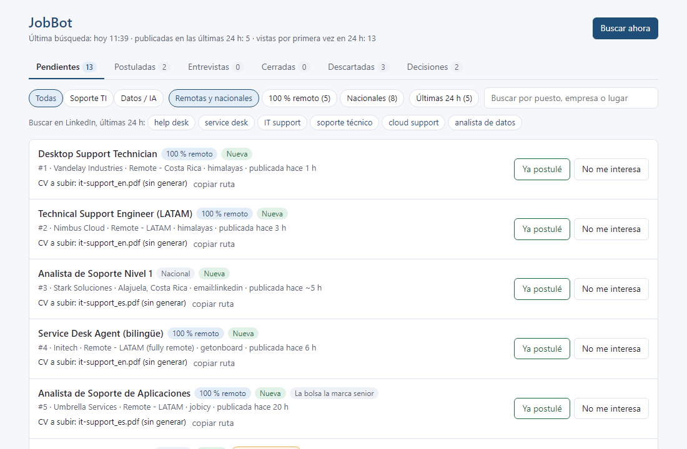
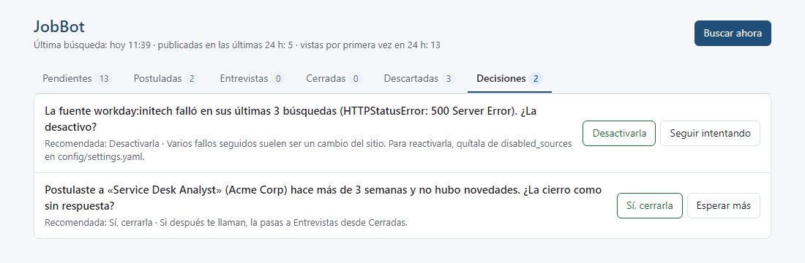
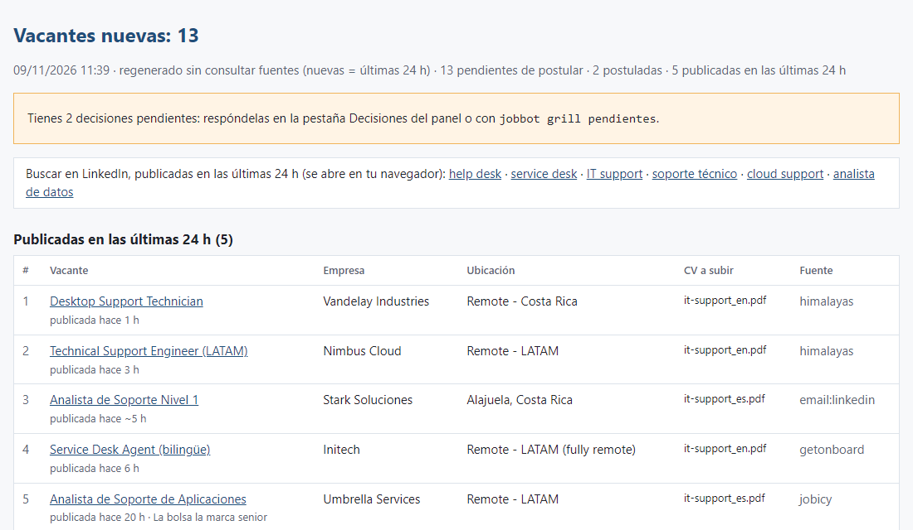

# JobBot

[Read in English](README.md)

JobBot es una herramienta local para buscar empleo de soporte TI. Revisa sitios de empleo de empresas y APIs públicas de bolsas de trabajo, descarta lo que no encaja, quita duplicados y te muestra el resto en un panel web en tu propia computadora, junto con el CV que conviene subir. **Nunca postula por ti:** tú decides y tú postulas.

Trae presets para Costa Rica (presencial, híbrido y remoto) y para trabajo remoto en Latinoamérica. Otros países se agregan como presets nuevos.



## Qué hace

- **Descubre vacantes en fuentes públicas:** sitios de empleo de empresas en Workday, SAP SuccessFactors, Greenhouse, Lever, Ashby, Recruitee, iCIMS, Jibe y amazon.jobs, más la página de empleos de Deel; las bolsas Get on Board, Remotive, Jobicy y Himalayas; los listados públicos de elempleo.
- **Alertas por correo (opcional):** lee las alertas de empleo que LinkedIn, CompuTrabajo, Indeed y elempleo envían a tu Gmail, con permiso de solo lectura. Las confirmaciones de postulación de esos sitios marcan la vacante como postulada.
- **Filtros con motivo:** familias de roles (soporte TI, datos), seniority, ubicación y requisitos excluyentes como autorización de seguridad. Cada vacante descartada guarda el motivo y puedes recuperarla.
- **Detecta duplicados** entre fuentes y avisa si una vacante abierta se parece a una a la que ya postulaste.
- **Lo más reciente primero:** cada vacante dice cuándo se publicó, el panel puede mostrar solo las de las últimas 24 h y el informe diario empieza por ellas. Las recomendaciones de LinkedIn, que pueden tener meses, llevan una marca. Un clic abre en tu navegador la búsqueda de LinkedIn de las últimas 24 h, en tu país o remoto en Latinoamérica. Nada de más de 30 días queda en tus listas.
- **Panel local** en el navegador: Pendientes, Postuladas, Entrevistas, Cerradas, Descartadas y Decisiones, con preguntas cortas del bot.
- **CV por vacante:** sugiere la variante de CV según la familia de roles y el idioma del anuncio. Opcional: genera los PDF desde YAML, con revisiones que bloquean afirmaciones que no puedes respaldar.
- **Entrevista de perfil:** `jobbot grill setup-profile` hace preguntas numeradas por rondas, con opciones cortas y, en las preferencias, una respuesta recomendada (Enter la acepta). Nunca adivina datos tuyos, muestra cada cambio y no escribe nada hasta que confirmes.
- **Decisiones en segundo plano:** después de cada corrida diaria, como máximo 3 preguntas nuevas por día (cerrar una postulación sin novedades en 21 días, desactivar una fuente que falla seguido, agregar una habilidad que piden muchas vacantes). Se responden en el panel o con `jobbot grill pendientes`.
- **Corrida diaria:** búsqueda programada, informe HTML y, en Windows, una notificación de escritorio.

## Privacidad primero, todo local

- Todo corre en tu computadora. No hay servidor, cuenta ni telemetría.
- Tus datos viven en una sola carpeta fuera del código: `JOBBOT_HOME`, que por defecto es la carpeta `JobBot` de tu usuario (`C:\Users\<Usuario>\JobBot` en Windows, `~/JobBot` en Linux y macOS). Nada de esa carpeta forma parte del repositorio.
- El panel solo escucha en `127.0.0.1`.
- El acceso a Gmail es opcional y de solo lectura (`gmail.readonly`). JobBot nunca envía, borra ni modifica correos.

## Inicio rápido

Necesitas [uv](https://docs.astral.sh/uv/) (instala Python 3.11+ por ti) y Git.

```bash
git clone https://github.com/<usuario>/jobbot.git
cd jobbot
uv sync
uv run jobbot init --preset costa-rica-it     # o: --preset remote-latam
uv run jobbot grill setup-profile             # entrevista corta sobre tu perfil y tu búsqueda
uv run jobbot discover                        # primera búsqueda
uv run jobbot panel                           # abre el panel en el navegador
```

`init` copia las plantillas del preset a tu carpeta de datos y nunca sobrescribe archivos que ya existen. El perfil que copia es un ejemplo ficticio: reemplázalo con tus datos (la entrevista cubre lo básico).

Guía paso a paso: [docs/getting-started.md](docs/getting-started.md).

### Presets

| Preset | Para qué |
| :--- | :--- |
| `costa-rica-it` (por defecto) | Soporte TI en Costa Rica: sitios de empleo de multinacionales (Workday, SuccessFactors, Amazon y otros), elempleo, reglas de ubicación locales y las bolsas remotas |
| `remote-latam` | Trabajo remoto abierto a Latinoamérica: Get on Board, Remotive, Jobicy y Himalayas. El país empieza vacío; `grill setup-profile` lo completa |

El país, la zona horaria y valores parecidos viven en el bloque `region` de `settings.yaml`. Las fuentes lo usan salvo que su entrada diga otra cosa, y sin país se reportan como "sin configurar" en vez de adivinar. Un país nuevo es casi siempre un preset nuevo. Las contribuciones son bienvenidas.

## Extras opcionales

| Extra | Instalación | Qué agrega |
| :--- | :--- | :--- |
| `gmail` | `uv sync --extra gmail` y luego `uv run jobbot gmail-login` | Alertas de empleo y confirmaciones de postulación desde tu correo, en solo lectura. Se activa con `email_alerts.enabled: true` en `targets.yaml` |
| `resumes` | `uv sync --extra resumes` y luego `uv run playwright install chromium` | CV en PDF desde `profile/resumes/*.yaml` con `uv run jobbot resumes` |

Para combinar extras: `uv sync --extra gmail --extra resumes`. `uv sync` instala exactamente lo que pides, así que repite los mismos `--extra` cada vez que lo corras.

El extra de Gmail necesita tu propio cliente OAuth de Google Cloud (app de escritorio). Mientras esa app esté en estado "Prueba" (*Testing*), Google vence la autorización más o menos cada 7 días: vuelve a correr `uv run jobbot gmail-login` cuando JobBot te lo pida.

**Windows** no necesita ningún extra: los scripts de `scripts/windows/` crean la tarea diaria y un acceso directo al panel, y la corrida diaria muestra una notificación de Windows.

## Corrida diaria

En Windows, el script crea la tarea "JobBot - busqueda diaria" en el Programador de tareas. Si la computadora estaba apagada a esa hora, la tarea corre al encenderla. Agrega `-JobbotHome <carpeta>` si tus datos no están en la carpeta por defecto y no definiste `JOBBOT_HOME`.

```powershell
powershell -ExecutionPolicy Bypass -File scripts\windows\install_schedule.ps1 -At 07:00
```

Linux y macOS usan cron con `scripts/run_daily.sh` (`crontab -e`; ajusta la ruta del proyecto):

```
0 7 * * * sh "$HOME/jobbot/scripts/run_daily.sh"
```

## Comandos

Se corren como `uv run jobbot <comando>` desde la carpeta del proyecto.

| Comando | Qué hace |
| :--- | :--- |
| `init --preset <nombre>` | Crea la carpeta de datos desde un preset (nunca sobrescribe) |
| `grill setup-profile` | Entrevista guiada que configura tu perfil y tu búsqueda |
| `grill pendientes` | Responder las preguntas que dejó la corrida diaria (lo mismo que la pestaña Decisiones) |
| `discover [--source X]` | Consulta todas las fuentes, o solo las que contienen `X` en el nombre |
| `daily` | `discover` + informe HTML + notificación + preguntas nuevas para Decisiones |
| `panel [--port N] [--db RUTA] [--no-browser]` | Panel local en el navegador |
| `jobs [--status S] [--family F] [--all] [--limit N]` | Lista vacantes, con el CV a subir |
| `applied <ids> [--undo]` | Marca vacantes a las que ya postulaste |
| `report [--open]` | Regenera el informe HTML sin usar la red |
| `stats` | Conteo por fuente y estado |
| `rescreen` | Reaplica `search.yaml` a lo guardado, sin usar la red |
| `resumes` | Genera los CV en PDF (extra CV en PDF) |
| `gmail-login` | Autoriza Gmail en solo lectura (extra Gmail) |
| `alerts-sample` | Guarda un correo de alerta real y prueba el lector |
| `alerts-status` | Cuántas alertas llegaron por sitio (solo encabezados) |

## Capturas

Todas las capturas usan empresas y enlaces ficticios; no son vacantes reales.

**Pestaña Decisiones.** JobBot te hace preguntas cortas cuando algo necesita tu criterio: una fuente que sigue fallando, una postulación sin novedades después de tres semanas o una habilidad que piden muchas vacantes y tu perfil no menciona.



**Informe diario.** La corrida programada genera un informe HTML que empieza por las vacantes publicadas en las últimas 24 h y agrupa el resto por familia de puesto, con el CV a subir y un aviso cuando ya postulaste a la misma vacante.



## Aviso legal

- Eres responsable de cumplir los términos de uso de cada sitio que uses con JobBot.
- JobBot solo lee listados públicos y APIs públicas, más tu propio correo si lo activas. Respeta un intervalo mínimo por sitio, `Retry-After` y los límites que publica cada fuente, y se identifica con un `User-Agent` honesto.
- No evade CAPTCHAs ni protecciones anti-bot. Si un sitio lo bloquea, esa fuente se detiene y lo reporta.
- Nunca envía postulaciones ni contacta a empleadores.
- JobBot no está afiliado a ningún sitio de empleo, proveedor de correo ni empleador que mencione.

## Documentación

| Tema | Archivo |
| :--- | :--- |
| Guía paso a paso | [docs/getting-started.md](docs/getting-started.md) |
| Requisitos | [docs/requirements.md](docs/requirements.md) |
| Arquitectura | [docs/architecture.md](docs/architecture.md) |
| Decisiones (ADR) | [docs/decisions.md](docs/decisions.md) |
| Estrategia de búsqueda | [docs/job-search.md](docs/job-search.md) |
| Fuentes | [docs/platforms/](docs/platforms/) |
| Planes | [ROADMAP.md](ROADMAP.md) |

## Contribuir

Los issues y pull requests son bienvenidos. Lee primero [CONTRIBUTING.md](CONTRIBUTING.md). Para reportar una vulnerabilidad, sigue [SECURITY.md](SECURITY.md).

## Licencia

[MIT](LICENSE).
