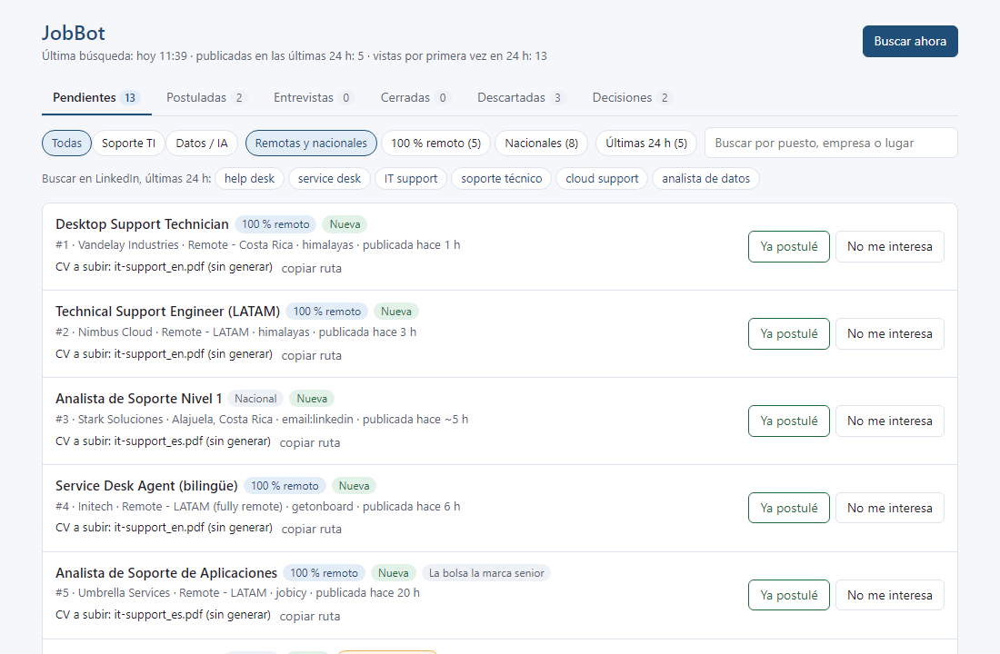
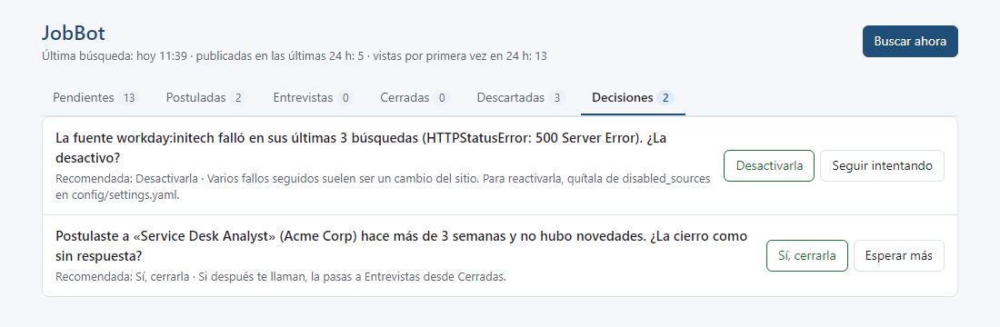
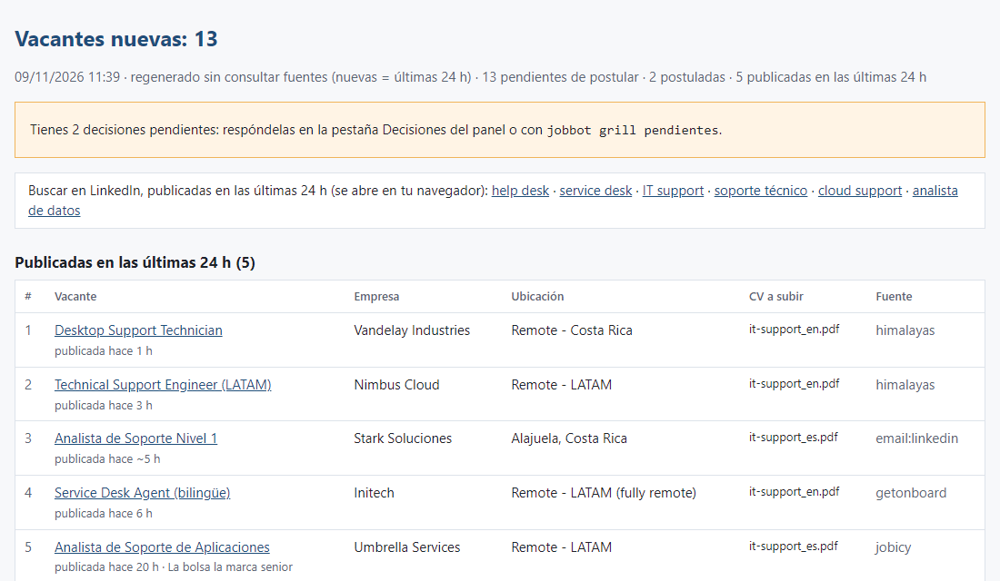

# JobBot

[Leer en español](README.es.md)

JobBot is a local job-search helper for IT support roles. It checks public career sites and job-board APIs, filters out what does not fit, removes duplicates and shows the rest in a small web panel on your own computer, together with the resume to upload. **It never applies for you:** you decide and you apply.

It ships with presets for Costa Rica (on-site, hybrid and remote) and for remote work across Latin America. Other countries can be added as presets.



## Features

- **Discovery from public sources:** company career sites on Workday, SAP SuccessFactors, Greenhouse, Lever, Ashby, Recruitee, Jibe and amazon.jobs, plus Deel's own careers page; the Get on Board, Remotive, Jobicy and Himalayas job boards; elempleo public listings.
- **Email alerts (optional):** reads the job alerts that LinkedIn, CompuTrabajo, Indeed and elempleo send to your Gmail, with a read-only permission. Application confirmations from those sites mark the job as applied.
- **Filters with a reason:** role families (IT support, data), seniority, location and hard blockers such as security clearance. Every discarded job keeps the reason, and you can bring it back.
- **Duplicate detection** across sources, plus a warning when an open job looks like one you already applied to.
- **Newest first:** each job shows when it was posted, the panel can show only the last 24 hours, and the daily report opens with them. LinkedIn's suggestions, which can be months old, are marked. One click opens LinkedIn's own search for the last 24 hours in your browser.
- **Local panel** in your browser: Pending, Applied, Interviews, Closed, Discarded and a Decisions tab with short questions from the bot.
- **Resume per job:** suggests the resume variant by role family and posting language. Optional PDF generation from YAML, with checks that block claims you cannot back up.
- **Profile interview:** `jobbot grill setup-profile` asks numbered questions in rounds, with short options and, for preferences, a recommended answer (Enter accepts it). It never guesses facts about you, shows every change and writes nothing until you confirm.
- **Decisions in the background:** after each daily run, at most 3 new questions a day (close an application with no news for 21 days, disable a source that keeps failing, add a skill many postings ask for). Answer them in the panel or with `jobbot grill pendientes`.
- **Daily run:** scheduled search, HTML report and, on Windows, a desktop notification.

## Privacy first, local only

- Everything runs on your computer. There is no server, no account and no telemetry.
- Your data lives in one folder outside the code: `JOBBOT_HOME`, by default a `JobBot` folder in your home directory (`C:\Users\<Usuario>\JobBot` on Windows, `~/JobBot` on Linux and macOS). Nothing in it is ever part of the repository.
- The panel listens on `127.0.0.1` only.
- Gmail access is optional and read-only (`gmail.readonly`). JobBot never sends, deletes or changes email.

## Quick start

You need [uv](https://docs.astral.sh/uv/) (it installs Python 3.11+ for you) and Git.

```bash
git clone https://github.com/<usuario>/jobbot.git
cd jobbot
uv sync
uv run jobbot init --preset costa-rica-it     # or: --preset remote-latam
uv run jobbot grill setup-profile             # short interview about your profile and search
uv run jobbot discover                        # first search
uv run jobbot panel                           # open the panel in your browser
```

`init` copies the preset templates into your data folder and never overwrites files that already exist. The profile it copies is a fictitious example: replace it with your own data (the interview covers the basics).

Full step-by-step guide (in Spanish): [docs/getting-started.md](docs/getting-started.md).

### Presets

| Preset | For |
| :--- | :--- |
| `costa-rica-it` (default) | IT support in Costa Rica: multinational career sites (Workday, SuccessFactors, Amazon and others), elempleo, local location rules, plus the remote boards |
| `remote-latam` | Remote work open to Latin America: Get on Board, Remotive, Jobicy and Himalayas. The country starts empty; `grill setup-profile` fills it in |

The country, time zone and similar values live in a `region` block in `settings.yaml`. Sources use it unless their own entry says otherwise, and with no country they report "sin configurar" instead of guessing. A new country is mostly a new preset. Contributions are welcome.

## Optional extras

| Extra | Install | What it adds |
| :--- | :--- | :--- |
| `gmail` | `uv sync --extra gmail`, then `uv run jobbot gmail-login` | Job alerts and application confirmations from your email, read-only. Turn it on with `email_alerts.enabled: true` in `targets.yaml` |
| `resumes` | `uv sync --extra resumes`, then `uv run playwright install chromium` | PDF resumes from `profile/resumes/*.yaml` with `uv run jobbot resumes` |

Combine extras with `uv sync --extra gmail --extra resumes`. `uv sync` installs exactly what you ask for, so repeat the same `--extra` flags every time you run it.

The Gmail extra needs your own Google Cloud OAuth client (desktop app). While that app is in "Testing" status, Google expires the authorization about every 7 days: run `uv run jobbot gmail-login` again when JobBot tells you.

**Windows** needs no extra: the scripts in `scripts/windows/` set up the daily task and a desktop shortcut for the panel, and the daily run shows a toast notification.

## Daily run

Windows creates the task "JobBot - busqueda diaria" in Task Scheduler. If the computer was off at that time, the task runs when it starts. Add `-JobbotHome <folder>` if your data is not in the default folder and `JOBBOT_HOME` is not set.

```powershell
powershell -ExecutionPolicy Bypass -File scripts\windows\install_schedule.ps1 -At 07:00
```

Linux and macOS use cron with `scripts/run_daily.sh` (`crontab -e`; adjust the project path):

```
0 7 * * * sh "$HOME/jobbot/scripts/run_daily.sh"
```

## Commands

Run them as `uv run jobbot <command>` from the project folder.

| Command | What it does |
| :--- | :--- |
| `init --preset <name>` | Create the data folder from a preset (never overwrites) |
| `grill setup-profile` | Guided interview that sets up your profile and search |
| `grill pendientes` | Answer the questions queued by the daily run (same as the Decisions tab) |
| `discover [--source X]` | Query every source, or only those whose name contains `X` |
| `daily` | `discover` + HTML report + notification + new questions for the Decisions tab |
| `panel [--port N] [--db PATH] [--no-browser]` | Local panel in the browser |
| `jobs [--status S] [--family F] [--all] [--limit N]` | List jobs, with the resume to upload |
| `applied <ids> [--undo]` | Mark jobs you already applied to |
| `report [--open]` | Rebuild the HTML report without network access |
| `stats` | Count jobs by source and status |
| `rescreen` | Re-apply `search.yaml` to stored jobs, without network access |
| `resumes` | Build the PDF resumes (Resumes extra) |
| `gmail-login` | Authorize read-only Gmail access (Gmail extra) |
| `alerts-sample` | Save a real alert email and test the parser |
| `alerts-status` | How many alert emails arrived per site (headers only) |

## Screenshots

All screenshots use fictitious companies and links; they are not real postings.

**Decisions tab.** JobBot asks short questions when something needs your call: a source that keeps failing, an application with no news after three weeks, or a skill that many postings ask for and your profile does not mention.



**Daily report.** The scheduled run writes an HTML report that opens with the jobs posted in the last 24 hours and groups the rest by role family, with the resume to upload and a warning when you already applied to the same opening.



## Legal notice

- You are responsible for complying with the terms of use of every site you use with JobBot.
- JobBot reads only public listings and public APIs, plus your own email if you enable it. It keeps a minimum interval per host, honors `Retry-After` and each source's documented limits, and identifies itself with an honest `User-Agent`.
- It does not bypass CAPTCHAs or bot protection. If a site blocks it, that source stops and reports it.
- It never submits applications and never contacts employers.
- JobBot is not affiliated with any job site, email provider or employer it mentions.

## Documentation

All documentation is in Spanish.

| Topic | File |
| :--- | :--- |
| Step-by-step guide | [docs/getting-started.md](docs/getting-started.md) |
| Requirements | [docs/requirements.md](docs/requirements.md) |
| Architecture | [docs/architecture.md](docs/architecture.md) |
| Decisions (ADRs) | [docs/decisions.md](docs/decisions.md) |
| Search strategy | [docs/job-search.md](docs/job-search.md) |
| Sources | [docs/platforms/](docs/platforms/) |
| Roadmap | [ROADMAP.md](ROADMAP.md) |

## Contributing

Issues and pull requests are welcome. Read [CONTRIBUTING.md](CONTRIBUTING.md) first. To report a vulnerability, follow [SECURITY.md](SECURITY.md).

## License

[MIT](LICENSE).
